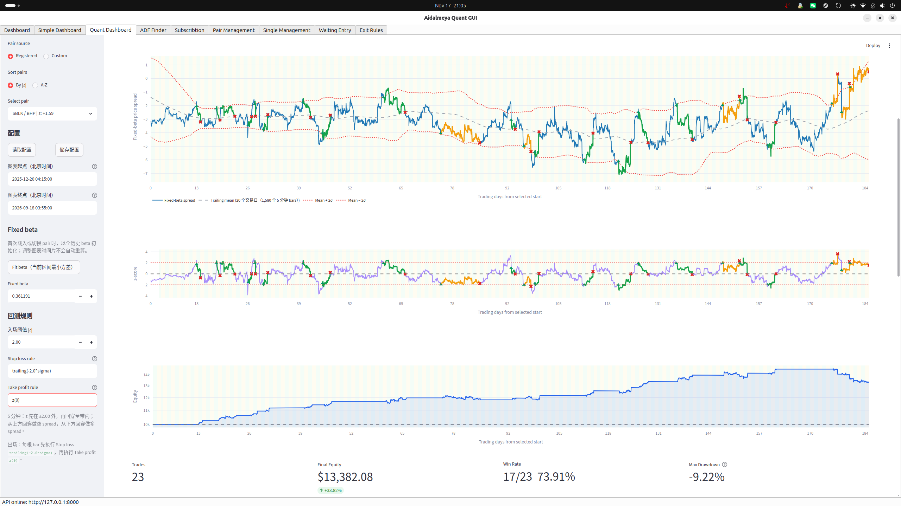
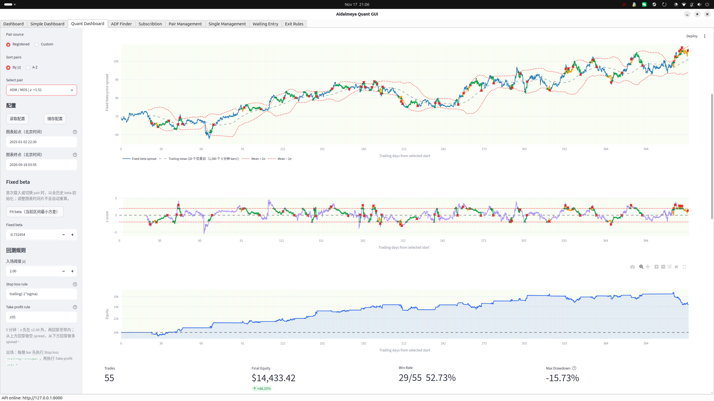
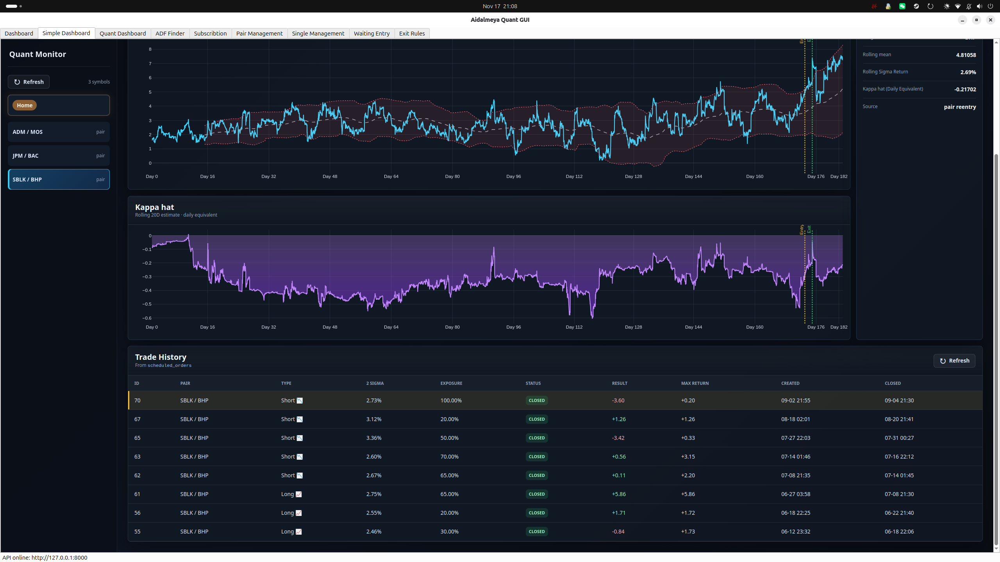
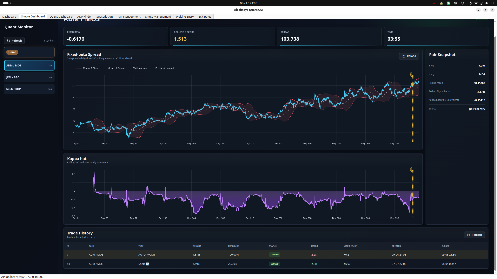

# East Indies Demo

## English

### Overview

East Indies Demo is a desktop-operated research and monitoring platform for statistical-arbitrage pairs. It brings together a PyQt control center, a Flask API, live market-data caching, signal monitoring, portfolio-risk views, and order-workflow tooling.

This repository is presented as a software-engineering and quantitative-research portfolio. It is not investment advice, and the public code must not be connected to a live brokerage account without independent review, safeguards, and appropriate authorization.

### System architecture

```text
quant_gui.py
  ├─ app.py ─────────────────────────── Flask API + simple dashboard
  ├─ quant_dashboard_fixed_beta.py ─── analytics dashboard
  ├─ pair_backtest_game.py ─────────── interactive pair backtest view
  ├─ single_price_dashboard.py ─────── single-instrument research view
  ├─ scheduler.pyw ─────────────────── scheduled local workflows
  ├─ livedata.py ───────────────────── market data → Redis/live bars
  ├─ waiting_entry.py ──────────────── entry monitoring and scheduling
  └─ flagship_board.py ─────────────── position monitoring and exit rules
        └─ program_factory/ ────────── shared execution and state components
```

`quant_gui.py` is the local control plane: it starts services, shows their status, embeds dashboards, and exposes operational controls. `app.py` is the UI read-model boundary. It reads persisted data and compact worker snapshots, then provides a narrow HTTP API so browser clients do not access MySQL or Redis directly.

### Main components

| Component | Responsibility |
| --- | --- |
| `quant_gui.py` | PyQt6 service controller, embedded dashboards, and operational configuration UI |
| `app.py` | Flask API for pair statistics, rolling baselines, market calendar, and worker snapshots |
| `livedata.py` | Market-data ingestion and completed-bar publication to Redis |
| `waiting_entry.py` | Candidate-entry monitoring and order scheduling |
| `flagship_board.py` | Active-position monitoring, risk views, and configurable exit workflow |
| `program_factory/` | Shared market-session, lifecycle, scheduling, live-bar, and execution primitives |
| `components/` | Reusable local frontend assets, including the draggable training chart and the Batteries range navigator |

### Data maintenance and research utilities

The root directory also contains deliberately separate maintenance programs and exploratory applications. They are not all long-running production services: the distinction matters because a backfill or targeted repair should be run intentionally, while the GUI-managed watchdogs can run continuously.

| Program | Role | How it is used |
| --- | --- | --- |
| `build_quantdata.py` | Incrementally backfills adjusted U.S. daily closes from IB Gateway for the active ranked universe into `quant_data.us_market_days`. It records exceptions and can fall back from SMART adjusted data to a direct-exchange or trade-price request. | Manual/batch data build; not a GUI-started worker. |
| `data_repair.py` | Repairs missing regular-session five-minute bars for explicitly named Beijing dates and tickers in `quant_data.us_market_prices`. | Targeted repair utility; supports dry runs. |
| `live_repair.py` | Audits recently closed five-minute slots and invokes `data_repair.py` only when it finds archival gaps. It is outside the trading-signal path. | GUI-managed background integrity watchdog. |
| `batteries_lab.py` | Interactive fixed-beta research laboratory for inspecting candidate trade episodes (“batteries”), their confirmation, failure, and portfolio-combination assumptions. | Manually launched Streamlit research app; not the execution dashboard. |
| `pair_backtest_game.py` | Interactive pair backtest view for examining a chosen pair and its assumptions. | GUI-started on demand. |
| `single_price_dashboard.py` | Single-instrument research page with price context and a separately scheduled single-instrument order workflow. | GUI-started on demand as “Single Stock Game.” |

The operational data path is therefore: `build_quantdata.py` maintains the daily research table; `livedata.py` publishes live prices and completed bars; `live_repair.py` and `data_repair.py` repair missing archival five-minute bars when necessary. The research applications consume these stored data sets but do not replace the entry, risk, or execution workers.

### Operational support, notification, and public mirror

| Program | Role | Status and boundary |
| --- | --- | --- |
| `batteries_navigator_component.py` | Streamlit Python bridge that registers and renders the Batteries navigator assets in `components/batteries_navigator/`. | Imported by `batteries_lab.py` and `quant_dashboard_fixed_beta.py`; it is not a duplicate browser component. |
| `runtime_settings.py` | Loads environment variables and an optional local `.env`, then supplies database, Redis, API, IBKR host, and account-mapping configuration to shared consumers. | Configuration boundary: secrets and account identifiers belong in `.env`, never source code. |
| `iphone_push.py` | Sends a test or operational notification through Bark, using local Bark configuration. | Notification transport; it does not decide when a trade should occur. |
| `position_reporter.py` | Reads the local flagship-board API and trade-event log, formats a compact position and event report, and sends it through `iphone_push.py`. | Scheduled by `scheduler.pyw` at market open, midnight, and close in Beijing time. |
| `public_dashboard_tunnel.py` | Maintains an outbound reverse SSH tunnel from the private machine to the public read-only dashboard host. | Scheduler-started connectivity service; the public host cannot initiate a connection back to the private machine. |
| `public_dashboard_sync.py` | Fetches selected local read-only API responses, writes one static JSON snapshot, and copies it to the public host every two minutes. | Optional/manual publisher in the current source tree; it is not started by `scheduler.pyw`. |

The Python file `batteries_navigator_component.py` is intentionally not the browser component itself. It is the small Streamlit adapter that declares the client-side package located at `components/batteries_navigator/`; separating the adapter from the HTML/JavaScript assets lets ordinary Python modules import the navigator directly.

### `program_factory/`: shared operational layer

`program_factory/` is the shared layer between the service processes and the manual-operation tools. It contains domain-level building blocks rather than a second UI or a standalone strategy.

| Module | Role | Main consumers |
| --- | --- | --- |
| `market_schedule.py` | New York market-session parsing, timing, and calendar helpers | `livedata.py`, `live_repair.py`, scheduled workflows |
| `live_bars.py` | Redis key conventions and validation for completed five-minute bars | `livedata.py`, `app.py`, `waiting_entry.py`, `flagship_board.py` |
| `pdt.py` | Position lifecycle state and database synchronization. Originally designed around the U.S. Pattern Day Trader (PDT) gate for sub-$25k accounts; the gate is currently disabled, so its active role is `NEW`/`HOLD` lifecycle detection. | `waiting_entry.py`, `flagship_board.py` |
| `order_scheduling.py` | Validated creation of pending pair and single-instrument order records | dashboards, GUI, and entry workflow |
| `execution.py` | Exit-rule interpretation, exposure capping, broker connection management, and position-close bookkeeping | `flagship_board.py`, manual order tools, `CombosLib.py` |
| `CombosLib.py` | Two-leg pair order construction using shared exposure controls | `waiting_entry.py` |
| `port_listener.py` | Detects configured local IBKR listener ports and selects the associated account mapping | workers and manual order tools |
| `trade_event_log.py` | Append-only local event audit trail | position and order workflows |
| `redis_client.py` | Shared Redis client configured from the local environment | utility consumers |

The dependency direction is intentionally one-way: UI and workers call `program_factory`; the shared layer does not import GUI code. Live data is published to Redis, workers consume those snapshots and persist workflow state, and `app.py` exposes read-only summaries to dashboards. Execution-capable functions remain local and require explicit `.env` configuration.

`pdt.py` retains the historical PDT-policy switch (`DAY_TRADE_LIMIT_ENABLED`) for environments where it is relevant. In the current workflow it is disabled: position age is still synchronized and classified as `NEW` or `HOLD`, but the U.S. sub-$25k day-trading gate is not applied.

### Universe discovery: liquidity and pair screening

The project does not begin with a fixed watchlist. `stock_listings/` and `adf_finder/` form a research pipeline for discovering liquid U.S. equity and ETF pairs with statistical-arbitrage potential comparable in shape to the SBLK/BHP research anchor.

| Component | Purpose |
| --- | --- |
| `stock_listings/` | Builds a broad U.S. stocks-and-ETFs universe from exchange listings and market-data snapshots. It records dollar-volume measures, filters unsuitable instruments such as test issues and selected leveraged ETFs, and provides a static inspection page. |
| `adf_finder/` | Scans active daily-price pairs over a fixed rolling window. For each candidate it estimates an OLS hedge ratio, tests the residual spread with ADF, measures spread volatility and theoretical two-sigma return space, and saves results for review. |

The screening logic is deliberately layered:

```text
U.S. listings → liquidity universe → aligned daily prices → unordered pair scan
→ hedge ratio and residual spread → ADF / stability screen → 2σ return-space screen
→ economic review and execution feasibility → monitored candidate
```

The goal is not to declare a pair profitable from one statistic. It is to find candidates with a recognizable mean-reverting relationship, sufficient estimated 2σ gross spread space to plausibly absorb trading frictions, and enough liquidity for realistic entry and exit. SBLK/BHP is a useful research reference point for the desired combination of cyclical relationship and tradable spread space; it is not a hard-coded template or a guarantee that similar-looking pairs will work.

### Mathematics research notebooks and labs

`Mathematics/` is the project’s methods layer: a collection of Jupyter, Wolfram Language, and Mathematica notebooks used to derive, test, and visualize the assumptions behind the pair workflow. These materials are deliberately more rigorous than dashboard documentation: they make the statistical object, the available information set, and the limitation of each diagnostic explicit. They are research and teaching artifacts, not a direct production-execution dependency.

#### 1. Causal measurement is the common constraint

Every live statistic is attached to an information time. If a signal is evaluated after bar $t$ closes, it may use observations through $t$; if an order must be decided before that close, it may only use observations through $t-1$. This distinction is carried through rolling means, volatility, derivatives, z-scores, regression coefficients, and backtests. `rolling_mean_derivative_no_future.md`, `rolling_mean_derivative_*`, and `trailing_sigma_*` focus on this timing discipline.

For a trailing window of $w$ observations, the moving mean and its one-step causal slope are:

$$
M_t=\frac{1}{w}\sum_{k=0}^{w-1}P_{t-k},\qquad
M_t-M_{t-1}=\frac{P_t-P_{t-w}}{w}.
$$

The second identity is useful because it shows exactly which two prices move a rolling average on each new bar. It does not use a centered window or a future point.

#### 2. Fixed-beta spread construction

The fixed-beta studies (`fixed_beta_pair_spread_lesson.ipynb`, `fixed_beta_adf_and_rolling_mean_lesson.ipynb`, and `AACENXDailyMovingAverageLab.wl`) start with aligned observations for two legs, $Y_t$ and $X_t$, and define:

$$
S_t=Y_t-\beta X_t.
$$

The research question is not “which beta looks best on the full chart?” A beta is estimated on a declared training range, then frozen before subsequent evaluation. One laboratory estimator first removes each leg’s endpoint trend, then finds the least-squares fixed hedge ratio:

$$
\beta^*=\frac{\sum_tD(X)_tD(Y)_t}{\sum_tD(X)_t^2},
$$

where $D(\cdot)$ denotes endpoint detrending. This gives a stable, interpretable training-period hedge ratio; it is not a claim that the ratio will remain optimal forever. The notebooks explicitly compare raw-price and normalized-leg conventions, because beta units, nominal exposure, and interpretation change with that choice.

#### 3. Trailing spread state: mean, sigma, z-score, and 2σ space

With beta frozen, the live state is measured with a trailing window rather than a full-sample estimate:

$$
\mu_t=\frac{1}{w}\sum_{k=0}^{w-1}S_{t-k},\qquad
\sigma_t=\sqrt{\frac{1}{w-1}\sum_{k=0}^{w-1}(S_{t-k}-\mu_t)^2},\qquad
z_t=\frac{S_t-\mu_t}{\sigma_t}.
$$

The bands $\mu_t\pm2\sigma_t$ provide a comparable scale for a current deviation and a way to estimate gross return space. They are not a 95% reversal probability: real spreads can be autocorrelated, heavy-tailed, volatile, and structurally unstable. This is why the universe scan treats 2σ return space as one candidate-quality requirement alongside liquidity and ADF/stability evidence, rather than a standalone trading signal.

#### 4. Qualification tests are separate from execution coordinates

The ADF research distinguishes a fixed spread from a rolling-filtered chart. The qualification regression is conceptually:

$$
\Delta S_t=c+\gamma S_{t-1}+\sum_{i=1}^{p}\phi_i\Delta S_{t-i}+\varepsilon_t,
$$

where an ADF test asks whether the fixed-definition spread has unit-root evidence. A rolling mean is useful for an execution coordinate system, but it is not an ADF input: subtracting a rolling mean transforms the process and can make even a random walk appear stationary. The notebooks therefore separate training-window ADF evidence from rolling z-score monitoring, and state that neither a low p-value nor a large z-score proves future profitability.

#### 5. Mean-reversion speed, λ, and half-life

The half-life labs model a local linear approximation:

$$
\Delta S_t=a+\lambda S_{t-1}+\varepsilon_t,qquad
\mu=-a/\lambda.
$$

When $-1<\lambda<0$, the corresponding discrete AR(1) proxy has a half-life in sample steps:

$$
h_{1/2}=\frac{\ln(1/2)}{\ln(1+\lambda)}.
$$

The familiar $-\ln(2)/\lambda$ expression is only a small-$|\lambda|$ approximation. A non-negative fitted lambda means the window does not support this contraction interpretation; values at or below $-1$ also do not define the same-side half-life. `half_life_and_across_density_*`, `instant_lambda_*`, and `models_for_unpredictable_AR1_to_ARMA11*` use controlled AR/ARMA and sinusoidal examples to show why a one-step ratio, a rolling OLS slope, and a physical cycle period are different quantities.

#### 6. Episodes, κ, and regime diagnostics

`cumulative_kappa_episode_model.ipynb` adds an episode-level view. Around a neutral z-score zone $[-z_0,z_0]$, it defines an outside-distance measure:

$$
r_t=\max(|z_t|-z_0,0),\qquad \Delta r_t\approx\kappa r_{t-1}.
$$

The first move out of the neutral zone is treated as direction selection rather than mean-reversion evidence; subsequent eligible transitions estimate whether the excursion is shrinking ($\kappa<0$) or expanding ($\kappa>0$). This provides a more robust state description than treating each one-bar $\Delta z/z$ ratio as a trading fact.

The complementary equity-regime study converts a backtest equity path into a causal, risk-adjusted colour score using recent log returns, volatility, and drawdown. It is a diagnostic for comparing strategy environments, not a permission to turn a strategy on without an independent out-of-sample test.

#### 7. Notebook-by-notebook research catalogue

The catalogue follows the original file-creation order. Lessons 1–3 are the model infrastructure: causal moving-average changes, a fixed-beta spread, and its trailing deviation scale.

| Order | Notebook | Problem it attempts to solve | Method and boundary |
| --- | --- | --- | --- |
| 1 | `rolling_mean_derivative_lesson.ipynb` | Define and calculate the rate of change of a moving average without using future data. | Proves the backward-difference identity $(P_t-P_{t-20})/20$ and contrasts it with future-contaminated smoothing derivatives. |
| 2 | `fixed_beta_pair_spread_lesson.ipynb` | Find a beta hedge ratio that can be fixed and used consistently. | Derives a fixed beta from endpoint-detrended least squares; separates a training-period beta estimate from later out-of-sample use. |
| 3 | `trailing_sigma_lesson.ipynb` | Define volatility thresholds for a spread. | Defines trailing mean, sample sigma, z-score, and ±2σ bands; explains timestamp alignment and why the bands are not reversal probabilities. |
| 4 | `half_life_and_across_density_lesson.ipynb` | Understand how half-life is calculated. | Fits rolling OLS lambda, maps valid negative values to discrete half-life, and compares reversion speed with confirmed zero-crossing / excursion density. |
| 5 | `models_for_unpredictable_AR1_to_ARMA11.ipynb` | A plain-language introduction to time-series modelling. | Uses AR, MA, and ARMA examples to distinguish persistence, shocks, forecasting uncertainty, and inappropriate overconfidence in a fitted model. |
| 6 | `cumulative_kappa_episode_model.ipynb` | Measure whether an active deviation episode is shrinking or expanding. | Replaces fragile pointwise $\Delta z/z$ with rolling OLS on distance outside a neutral zone; it is a state descriptor, not an entry signal. |
| 7 | `trading_batteries_selecting_lesson.ipynb` | Identify repeatable, risk-bounded trade episodes that could be combined into a portfolio of “batteries.” | Tests the idea that prompt confirmation, sustained favourable conditions, and explicit failure exits matter more than optimizing a static spread-variance beta. |
| 8 | `fixed_beta_adf_and_rolling_mean_lesson.ipynb` | Prevent ADF p-values from being misread on dashboard charts. | Shows why ADF applies to a fixed-definition spread, not to a rolling-mean residual or rolling z-score; documents the filtering-induced false-stationarity risk. |
| 9 | `equity_regime_colour_lesson.ipynb` | Compare when different backtested strategies operate in favourable or unfavourable environments. | Builds a causal colour score from rolling log-return strength, volatility, and drawdown; requires a separate out-of-sample test before use as a timing rule. |
| 10 | `time_series_tests_from_questions_lesson.ipynb` | Redesign the statistical qualification layer of `adf_finder`, rather than treating its ADF output as a one-number ranking. | Uses BG/DW/NW/FGLS, DF/ADF, Engle–Granger, and ECM to specify a layered scanner: a predeclared long training window and correctly calibrated cointegration gate; separate 2σ/liquidity/cost trading filters; repeated historical as-of out-of-sample checks; and multiple-testing awareness across a large pair universe. It also reproduces an 80-bar NKE/XPO scan and distinguishes structural-break diagnostics from live qualification. |

The `.nb` and `.wl` files are companion blackboards and interactive laboratories for these notebooks: `trailing_sigma_workshop.nb` supports the trailing-band lesson; `rolling_mean_derivative_blackboard.nb`, `half_life_and_across_density_blackboard.nb`, and `instant_lambda_trading_days_blackboard.nb` make the derivations manipulable; `AACENXDailyMovingAverageLab.wl` and `trading_batteries_selecting_blackboard.wl` apply the concepts to selectable pairs. Their role is to expose assumptions visually and permit controlled counterexamples, not to add hidden production rules.

For `adf_finder` specifically, this notebook proposes a clear division of labour. A fixed, predeclared trailing training window supplies the statistical qualification test; when the hedge ratio is estimated from the same prices, Engle–Granger cointegration is the correctly framed qualification problem rather than a raw ADF p-value on estimated residuals. The scanner should rank in the correct left-tail direction (more negative ADF statistic / smaller calibrated p-value), not by $|ADF|$. A separate trading-qualification layer then examines 2σ gross-notional return space, excursion frequency, half-life, liquidity, spread, and borrow/cost assumptions. Finally, the complete selector must be tested at multiple historical as-of dates and account for the large false-positive burden created by scanning millions of possible pairs.

#### 8. How the mathematics connects to the application

```text
Aligned prices and liquidity
        ↓
Frozen training-period beta and fixed-spread qualification
        ↓
ADF / residual diagnostics / stability review
        ↓
Live trailing mean, sigma, z-score, λ or κ state estimates
        ↓
Entry, exit, risk, and regime decisions subject to cost and liquidity checks
```

The research materials repeatedly enforce the same boundary: a statistical property—stationarity, a negative λ, a short estimated half-life, or a wide 2σ band—is evidence to investigate, not evidence of an executable edge by itself. A production candidate must also survive liquidity, costs, execution constraints, parameter stability, and independent future-sample evaluation.

### Local setup

```bash
python -m venv .venv
source .venv/bin/activate  # Windows: .venv\Scripts\activate
pip install -r requirements.txt
```

Copy `.env.example` to `.env` and supply local MySQL, Redis, API, and—only if needed—IBKR configuration. Credentials and account mappings are intentionally not stored in source code.

For a local rule file, copy `program_factory/pair_exit_rules.example.json` to `program_factory/pair_exit_rules.json` and adapt the example values. The active rule file is intentionally excluded from Git.

Then start the control center:

```bash
python quant_gui.py
```

See [README_GUI.md](README_GUI.md) for GUI operation and [docs/architecture.md](docs/architecture.md) for detailed component boundaries.

### Public-release policy

The repository excludes credentials, account identifiers, logs, positions, market-data exports, local databases, virtual environments, generated artifacts, and third-party reference projects. Before publishing, follow [docs/publication-checklist.md](docs/publication-checklist.md).

The codebase is still undergoing a final audit of execution-facing modules. It should not be made public until every remaining module has been checked for embedded credentials, account data, and private runtime details.

---

## 中文

### 项目概述

East Indies Demo 是一个面向统计套利配对交易的桌面端研究与监控平台。系统整合了 PyQt 控制中心、Flask API、实时行情缓存、信号监控、组合风控视图和订单工作流工具。

本仓库用于展示软件工程与量化研究能力，不构成投资建议。公开版本在未经独立审查、风控保障及适当授权前，不应连接任何实盘券商账户。

### 系统架构

```text
quant_gui.py
  ├─ app.py ─────────────────────────── Flask API 与简易看板
  ├─ quant_dashboard_fixed_beta.py ─── 数据分析看板
  ├─ pair_backtest_game.py ─────────── 配对交易交互式回测界面
  ├─ single_price_dashboard.py ─────── 单标的研究界面
  ├─ scheduler.pyw ─────────────────── 本地定时工作流
  ├─ livedata.py ───────────────────── 行情数据 → Redis / 实时 Bar
  ├─ waiting_entry.py ──────────────── 入场信号监控与排程
  └─ flagship_board.py ─────────────── 持仓监控与退出规则
        └─ program_factory/ ────────── 共享执行与状态组件
```

`quant_gui.py` 是本地控制中心，负责服务启动、停止、状态展示、嵌入式看板及日常操作入口。`app.py` 是面向界面的数据读取边界：它读取数据库与后台服务发布的紧凑快照，再提供受限 HTTP API，因此浏览器不会直接访问 MySQL 或 Redis。

### 核心组成

| 组件 | 职责 |
| --- | --- |
| `quant_gui.py` | PyQt6 服务控制器、嵌入式看板与运营配置界面 |
| `app.py` | 提供配对统计、滚动基线、市场日历与后台快照的 Flask API |
| `livedata.py` | 行情采集与完成 Bar 发布到 Redis |
| `waiting_entry.py` | 候选入场信号监控与订单排程 |
| `flagship_board.py` | 活跃持仓监控、风险视图和可配置退出流程 |
| `program_factory/` | 市场时段、生命周期、订单排程、实时 Bar 与执行的共享基础组件 |
| `components/` | 可复用本地前端资产，包括可拖动训练图表与 Batteries 区间导航器 |

### 数据维护与研究工具

根目录中还保留了一组刻意独立的数据维护程序和探索性应用。它们并不都是常驻生产服务：批量回填或定点修复应当由人明确触发；GUI 管理的巡检程序则可以持续运行。这一区分很重要。

| 程序 | 职责 | 使用方式 |
| --- | --- | --- |
| `build_quantdata.py` | 从 IB Gateway 增量回填活跃排名证券池的调整后美国日线，写入 `quant_data.us_market_days`。记录异常，并可从 SMART 的调整数据回退至交易所直连或成交价请求。 | 手动/批量建库；不由 GUI 自动启动。 |
| `data_repair.py` | 针对明确给出的北京时间日期与 ticker，修补 `quant_data.us_market_prices` 中缺失的正常交易时段五分钟 bar。 | 定点修复工具；支持 dry run。 |
| `live_repair.py` | 审计最近已收盘的五分钟时段；只有发现归档缺口时才调用 `data_repair.py`。它不在交易信号路径中。 | GUI 管理的后台数据完整性巡检服务。 |
| `batteries_lab.py` | 用于检查候选交易片段（“batteries”）及其确认、失效和组合假设的交互式 fixed-beta 研究实验室。 | 手动启动的 Streamlit 研究应用；不是执行看板。 |
| `pair_backtest_game.py` | 用于审视指定配对及其假设的交互式配对回测界面。 | 由 GUI 按需启动。 |
| `single_price_dashboard.py` | 提供单标的价格语境，并配有独立排程的单标的订单工作流的研究页面。 | 由 GUI 按需以 “Single Stock Game” 启动。 |

因此，运行层的数据路径是：`build_quantdata.py` 维护日线研究表；`livedata.py` 发布实时价格和已完成的 bar；需要时由 `live_repair.py` 与 `data_repair.py` 修补缺失的归档五分钟 bar。研究应用读取这些已存数据，但不替代入场、风控或执行后台服务。

### 运行支持、通知与公共只读镜像

| 程序 | 职责 | 状态与边界 |
| --- | --- | --- |
| `batteries_navigator_component.py` | 注册并渲染 `components/batteries_navigator/` 中 Batteries 导航器资产的 Streamlit Python 桥接层。 | 被 `batteries_lab.py` 和 `quant_dashboard_fixed_beta.py` 导入；它不是重复的浏览器组件。 |
| `runtime_settings.py` | 读取环境变量和可选的本地 `.env`，再向共享调用方提供数据库、Redis、API、IBKR 主机与账户映射配置。 | 配置边界：密钥与账户标识应留在 `.env`，绝不写入源码。 |
| `iphone_push.py` | 使用本地 Bark 配置发送测试或运行通知。 | 通知传输层；它不决定任何交易时机。 |
| `position_reporter.py` | 读取本机旗舰持仓 API 与交易事件日志，生成紧凑的持仓/事件报告，并通过 `iphone_push.py` 发送。 | 由 `scheduler.pyw` 在北京时间开盘、午夜和收盘时运行。 |
| `public_dashboard_tunnel.py` | 从私有机器向公共只读看板主机维持出站反向 SSH 隧道。 | 由 scheduler 启动的连通性服务；公共主机不能反向主动连接私有机器。 |
| `public_dashboard_sync.py` | 拉取选定的本地只读 API 响应，生成一个静态 JSON 快照，并每两分钟复制到公共主机。 | 当前源码中是可选/手动发布器；不由 `scheduler.pyw` 启动。 |

`batteries_navigator_component.py` 刻意不是浏览器组件本身。它是一个很小的 Streamlit 适配层，用来声明位于 `components/batteries_navigator/` 的客户端包；将该适配层和 HTML/JavaScript 资产分开，使普通 Python 模块可以直接导入导航器。

### `program_factory/`：共享运营层

`program_factory/` 是后台服务与手动操作工具之间的共享层。它提供的是业务领域基础模块，而不是第二套 UI 或独立策略。

| 模块 | 职责 | 主要调用方 |
| --- | --- | --- |
| `market_schedule.py` | 纽约市场时段解析、时间控制和交易日辅助函数 | `livedata.py`、`live_repair.py`、定时工作流 |
| `live_bars.py` | 已完成五分钟 Bar 的 Redis 键规范与数据校验 | `livedata.py`、`app.py`、`waiting_entry.py`、`flagship_board.py` |
| `pdt.py` | 仓位生命周期与数据库同步。最初用于处理美国账户低于 25,000 美元时的 PDT（Pattern Day Trader）限制；当前该开关已关闭，实际职责为 `NEW`/`HOLD` 生命周期识别。 | `waiting_entry.py`、`flagship_board.py` |
| `order_scheduling.py` | 对待执行的配对与单标的订单记录进行校验和创建 | 看板、GUI 与入场工作流 |
| `execution.py` | 退出规则解析、敞口上限、券商连接管理及平仓记账 | `flagship_board.py`、手动订单工具、`CombosLib.py` |
| `CombosLib.py` | 基于共享敞口控制构造两条腿的配对订单 | `waiting_entry.py` |
| `port_listener.py` | 检测本机已配置的 IBKR 监听端口，并选择对应账户映射 | 后台服务与手动订单工具 |
| `trade_event_log.py` | 追加式本地事件审计日志 | 仓位与订单工作流 |
| `redis_client.py` | 从本地环境配置创建共享 Redis 客户端 | 工具模块 |

依赖方向是单向的：GUI 和后台服务调用 `program_factory`，共享层不导入 GUI。实时行情先发布到 Redis，后台服务消费快照并写入工作流状态，`app.py` 再向看板提供只读汇总。包含执行能力的函数保持本地运行，且必须通过 `.env` 显式配置才能连接。

`pdt.py` 保留了历史上的 PDT 策略开关 `DAY_TRADE_LIMIT_ENABLED`，以便在需要时使用。当前工作流中该开关为关闭状态：系统仍会同步仓位进入时间并识别 `NEW` 或 `HOLD`，但不会应用美国账户低于 25,000 美元的典型日内交易限制。

### 全市场候选发现：流动性与配对筛选

项目并非从固定观察名单出发。`stock_listings/` 与 `adf_finder/` 构成研究管线，用于从美国股票和 ETF 市场中寻找在关系形态上可与 SBLK/BHP 研究锚点对照、且具有统计套利潜力的高流动性配对。

| 组件 | 作用 |
| --- | --- |
| `stock_listings/` | 基于交易所名录与市场数据快照建立覆盖广泛的美股及 ETF 标的池；记录成交额等流动性指标，排除测试证券和部分杠杆 ETF，并生成静态检查页面。 |
| `adf_finder/` | 在固定滚动窗口内扫描活跃标的的日线组合；对每个候选估计 OLS 对冲比率，用 ADF 检验残差价差，计算价差波动和理论 2σ 收益空间，并保存供进一步审阅。 |

筛选遵循分层逻辑：

```text
美股名录 → 流动性标的池 → 对齐日线价格 → 无序配对扫描
→ 对冲比率与残差价差 → ADF / 稳定性筛选 → 2σ 收益空间筛选
→ 经济关系审阅与执行可行性 → 进入监控候选池
```

目标不是依据单一统计量就宣称配对必然盈利，而是寻找同时具备可辨认的均值回归关系、足以在理论上覆盖交易摩擦的 2σ 毛价差空间，以及可实际进出场的流动性的候选。SBLK/BHP 是用来校准“周期关系 + 可交易价差空间”这一组合的研究参照，而不是硬编码模板，也不意味着外形相似的配对必然有效。

### Mathematics 数学研究笔记与实验室

`Mathematics/` 是项目的方法研究层：其中包含 Jupyter、Wolfram Language 和 Mathematica 笔记本，用于推导、检验和可视化配对交易工作流背后的假设。这些材料比看板说明更严格：它们明确每个统计对象、可用信息集合及诊断工具的限制。其用途是可复现研究与方法教学，而不是生产下单引擎的直接依赖。

#### 1. 因果测量是共同约束

每个实时统计量都必须绑定信息时点。若信号在第 $t$ 根 bar 收盘后计算，则可以使用截至 $t$ 的观测；若订单必须在收盘前决定，则只能使用截至 $t-1$ 的观测。这一区别贯穿滚动均值、波动率、导数、z-score、回归系数和回测。`rolling_mean_derivative_no_future.md`、`rolling_mean_derivative_*` 与 `trailing_sigma_*` 专门研究这一时间纪律。

对长度为 $w$ 的 trailing 窗口，移动均值及其一步因果斜率为：

$$
M_t=\frac{1}{w}\sum_{k=0}^{w-1}P_{t-k},\qquad
M_t-M_{t-1}=\frac{P_t-P_{t-w}}{w}.
$$

第二个恒等式精确说明：每出现一根新 bar，只有哪两个价格推动滚动均线变化。它既不使用居中窗口，也不使用未来点。

#### 2. 固定 beta 的价差构造

固定 beta 研究（`fixed_beta_pair_spread_lesson.ipynb`、`fixed_beta_adf_and_rolling_mean_lesson.ipynb`、`AACENXDailyMovingAverageLab.wl`）从两条腿 $Y_t$ 与 $X_t$ 的对齐观测开始，定义：

$$
S_t=Y_t-\beta X_t.
$$

研究问题不是“全图上哪个 beta 最好看”。beta 应在预先声明的训练区间内估计，然后在后续评价中冻结。一种实验估计器会先移除两条腿的端点趋势，再计算最小二乘固定对冲比率：

$$
\beta^*=\frac{\sum_tD(X)_tD(Y)_t}{\sum_tD(X)_t^2},
$$

其中 $D(\cdot)$ 表示端点去趋势。它给出稳定、可解释的训练期对冲比率，但不声称该比率会永久最优。笔记本还会比较原始价格和归一化双腿两种口径，因为 beta 的单位、名义敞口和经济解释都会随之改变。

#### 3. Trailing 价差状态：均值、sigma、z-score 与 2σ 空间

在 beta 冻结后，实时状态使用 trailing window，而不是全样本估计：

$$
\mu_t=\frac{1}{w}\sum_{k=0}^{w-1}S_{t-k},\qquad
\sigma_t=\sqrt{\frac{1}{w-1}\sum_{k=0}^{w-1}(S_{t-k}-\mu_t)^2},\qquad
z_t=\frac{S_t-\mu_t}{\sigma_t}.
$$

$\mu_t\pm2\sigma_t$ 提供了当前偏离的可比较刻度，以及估计毛收益空间的一种方式；它不是“有 95% 概率反转”。真实价差可能存在自相关、肥尾、波动聚集和结构变化。因此，全市场扫描将 2σ 收益空间与流动性、ADF/稳定性证据并列为候选质量条件，而不是把它当成单独的交易信号。

#### 4. 资格检验与执行坐标系必须分开

ADF 研究严格区分固定定义的价差与经过 rolling filter 的图表。资格检验的概念回归为：

$$
\Delta S_t=c+\gamma S_{t-1}+\sum_{i=1}^{p}\phi_i\Delta S_{t-i}+\varepsilon_t,
$$

ADF 要问的是固定定义的 spread 是否有单位根证据。rolling mean 对执行坐标系很有用，却不应作为 ADF 输入：减去 rolling mean 会改变随机过程，甚至可能让随机游走看起来平稳。因此，笔记本把训练窗 ADF 证据和滚动 z-score 监控分开；低 p-value 或大的 z-score 都不能单独证明未来盈利。

#### 5. 均值回归速度、λ 与 half-life

half-life 实验使用局部线性近似：

$$
\Delta S_t=a+\lambda S_{t-1}+\varepsilon_t,\qquad
\mu=-a/\lambda.
$$

仅当 $-1<\lambda<0$ 时，对应的离散 AR(1) 代理模型才存在以样本步数计的 half-life：

$$
h_{1/2}=\frac{\ln(1/2)}{\ln(1+\lambda)}.
$$

常见的 $-\ln(2)/\lambda$ 只是 $|\lambda|$ 很小时的近似。若拟合的 lambda 非负，窗口不支持“收缩”解释；若 lambda 小于等于 $-1$，也不定义同侧收缩意义下的 half-life。`half_life_and_across_density_*`、`instant_lambda_*` 和 `models_for_unpredictable_AR1_to_ARMA11*` 使用 AR/ARMA 与正弦对照，说明一步比值、滚动 OLS 斜率和物理周期是不同的量。

#### 6. Episode、κ 与 regime 诊断

`cumulative_kappa_episode_model.ipynb` 给出 episode 级视角。在中性 z-score 区 $[-z_0,z_0]$ 外，定义距离：

$$
r_t=\max(|z_t|-z_0,0),\qquad \Delta r_t\approx\kappa r_{t-1}.
$$

首次离开中性区被视为方向选择，而不被视为均值回归证据；之后的有效 transition 用于估计 excursion 正在收缩（$\kappa<0$）还是扩大（$\kappa>0$）。相比把每根 bar 的 $\Delta z/z$ 比率直接当作交易事实，这种状态描述更稳健。

与之配套的 equity-regime 研究会利用近期对数收益、波动率和回撤，将回测 equity path 压缩成因果的风险调整色带。它用于比较不同策略所处环境，不是未经独立样本外验证就自动开关策略的依据。

#### 7. 按 notebook 逐项说明的研究目录

目录按原始文件创建时间排列。第 1–3 课构成模型基建：因果的移动均线变化、固定 beta spread，以及该 spread 的 trailing 偏离刻度。

| 顺序 | Notebook | 尝试解决的问题 | 方法与边界 |
| --- | --- | --- | --- |
| 1 | `rolling_mean_derivative_lesson.ipynb` | 在没有未来数据的前提下定义和计算均线变化率。 | 证明后向差分恒等式 $(P_t-P_{t-20})/20$，并对比会混入未来数据的平滑导数。 |
| 2 | `fixed_beta_pair_spread_lesson.ipynb` | 找到一个可以固定的,可以持续使用的beta对冲比例 | 推导端点去趋势最小二乘得到的固定 beta；区分训练期 beta 估计与后续样本外使用。 |
| 3 | `trailing_sigma_lesson.ipynb` | 定义Spread波动阈值 | 定义 trailing mean、sample sigma、z-score 和 ±2σ 带；解释时间戳对齐及为何它们不是反转概率。 |
| 4 | `half_life_and_across_density_lesson.ipynb` | 理解half life的计算 | 拟合 rolling OLS lambda，将有效负值换算为离散 half-life，并把回归速度与确认过的零穿越/偏离密度比较。 |
| 5 | `models_for_unpredictable_AR1_to_ARMA11.ipynb` | 时间序列的朴素建模 | 用 AR、MA、ARMA 例子区分持续性、冲击、预测不确定性，以及对拟合模型产生过度自信的风险。 |
| 6 | `cumulative_kappa_episode_model.ipynb` | 衡量一段活跃偏离 episode 正在收缩还是扩大。 | 用中性区外距离的滚动 OLS 替代脆弱的逐点 $\Delta z/z$；它是状态描述，不是入场信号。 |
| 7 | `trading_batteries_selecting_lesson.ipynb` | 尝试识别可重复、风险有界、能够组合成 “batteries” 的交易片段。 | 检验快速确认、稳定有利条件与明确失效退出，比单纯优化静态 spread 方差 beta 更重要这一想法。 |
| 8 | `fixed_beta_adf_and_rolling_mean_lesson.ipynb` | 防止看板中的 ADF p-value 被错误解读。 | 说明 ADF 应检验固定定义的 spread，而不是 rolling mean 残差或 rolling z-score；记录滤波器导致的伪平稳风险。 |
| 9 | `equity_regime_colour_lesson.ipynb` | 比较不同回测策略在哪些市场环境中更有利或不利。 | 由滚动对数收益强度、波动率和回撤构建因果颜色分数；若要作为择时规则，仍须独立样本外检验。 |
| 10 | `time_series_tests_from_questions_lesson.ipynb` | 改造 `adf_finder` 的统计资格层，而不是把 ADF 输出当成一个单数字排名。 | 使用 BG/DW/NW/FGLS、DF/ADF、Engle–Granger 与 ECM，规定分层 scanner：预先声明的较长训练窗与正确校准的协整门槛；独立的 2σ/流动性/成本交易过滤；多历史 as-of 截点样本外检查；以及大规模 pair 宇宙中的多重检验意识。Notebook 还复现了 NKE/XPO 的 80-bar scan，并区分结构断裂诊断与实时资格检验。 |

`.nb` 与 `.wl` 文件是上述 notebook 的配套黑板和交互式实验室：`trailing_sigma_workshop.nb` 支持 trailing band 课程；`rolling_mean_derivative_blackboard.nb`、`half_life_and_across_density_blackboard.nb`、`instant_lambda_trading_days_blackboard.nb` 使推导可以交互观察；`AACENXDailyMovingAverageLab.wl` 与 `trading_batteries_selecting_blackboard.wl` 将概念应用于可选配对。它们的目的在于可视化假设、构造受控反例，而不是暗中新增生产规则。

对 `adf_finder` 而言，这个 notebook 提出了清晰的职责划分：预先声明的固定 trailing training window 提供统计资格检验；若对冲比率由同一批价格估计，则正确的资格问题是 Engle–Granger 协整，而不是对估计残差直接使用普通 ADF p-value。Scanner 排序也应遵循左尾方向（更负的 ADF statistic／更小的正确校准 p-value），而不是按 $|ADF|$。随后独立的交易资格层再考察 2σ gross-notional 收益空间、偏离频率、half-life、流动性、点差与借券/成本假设。最后，完整选择器必须在多个历史 as-of 日期上测试，并面对扫描数百万潜在配对时产生的大量假阳性问题。

#### 8. 数学研究如何连接到应用

```text
对齐价格与流动性
        ↓
训练期冻结 beta 与固定价差资格检验
        ↓
ADF / 残差诊断 / 稳定性审阅
        ↓
实时 trailing mean、sigma、z-score、λ 或 κ 状态估计
        ↓
在成本和流动性约束下作入场、退出、风控与 regime 决策
```

研究材料不断强调同一条边界：平稳性、负 lambda、较短的估计 half-life 或宽 2σ 带，都只是值得继续研究的证据，并不等同于可执行 edge。生产候选还必须经受流动性、成本、执行约束、参数稳定性和独立未来样本评估。

### 本地启动

```bash
python -m venv .venv
source .venv/bin/activate  # Windows: .venv\Scripts\activate
pip install -r requirements.txt
```

将 `.env.example` 复制为 `.env`，填写本机 MySQL、Redis、API，以及仅在需要时填写 IBKR 配置。密码与账户映射不会写入源码。

本地退出规则可由 `program_factory/pair_exit_rules.example.json` 复制为 `program_factory/pair_exit_rules.json` 后再自行填写；实际规则文件会被 Git 排除。

随后启动控制中心：

```bash
python quant_gui.py
```

GUI 的具体操作见 [README_GUI.md](README_GUI.md)，组件边界见 [docs/architecture.md](docs/architecture.md)。

### 公开仓库原则

本仓库会排除密码、账户标识、日志、仓位、行情导出、本地数据库、虚拟环境、生成产物以及第三方参考项目。发布前请按 [docs/publication-checklist.md](docs/publication-checklist.md) 完成检查。

执行相关模块仍在进行最终去敏审查；在确认所有文件均不含凭据、账户信息和私有运行细节前，不能公开推送。

---

## Performance snapshots / 成绩展示

These charts document selected strategy research and operating snapshots. The backtests are simulations, not actual trading results. The live-trading charts are historical records only and do not promise future performance.

以下图表展示部分策略研究与运行快照。回测结果属于模拟，不代表实际交易收益；实盘图表仅为历史记录，不构成对未来表现的承诺。

### Backtest simulations / 回测模拟

#### SBLK / BHP



#### ADM / MOS



### Live trading results / 实盘成绩

#### SBLK / BHP



#### ADM / MOS


